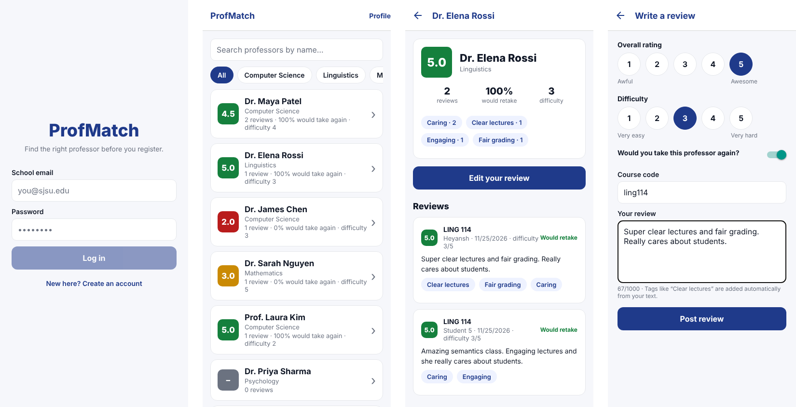

# ProfMatch

A full-stack mobile app where students search, rate, and review professors.



## Features
- **Search & filter** professors by name and department, with average rating,
  difficulty, and "would take again" %, all computed in SQL
- **Professor pages** with every review plus the most common auto-generated tags
- **Write / edit / delete reviews**: 1–5 rating, difficulty, would-take-again, course, text
- **Duplicate-review prevention**: one review per student per professor, enforced by a
  database `UNIQUE (user_id, professor_id)` constraint (the app offers "Edit" instead)
- **Text-based feedback parsing**: review text is scanned for phrases ("clear",
  "tough grader", "office hours"...) and turned into tags, with negation handling
  ("not clear" doesn't count as "Clear lectures")
- **Secure auth**: bcrypt password hashing, JWT sessions (7-day expiry), token stored in
  the phone's secure keychain (expo-secure-store), login rate limiting, server-side
  validation, parameterized SQL (no SQL injection)
- **Profile**: change display name, see your reviews, log out

## Tech stack
| Layer | Tech |
|---|---|
| Mobile app | React Native, Expo, React Navigation, React Context |
| API | Node.js, Express, JWT, bcrypt, express-rate-limit |
| Database | PostgreSQL (normalized schema, foreign keys, CHECK + UNIQUE constraints, indexes) |
| Testing | Jest + Supertest (18 tests against a real Postgres database) |

## Architecture
```
 Phone (React Native / Expo)
   │  HTTPS + JSON, "Authorization: Bearer <JWT>"
   ▼
 Express REST API (Node.js)
   │  parameterized SQL through a connection pool
   ▼
 PostgreSQL: users ── reviews ── professors ── departments
```

### Database schema
- `users(id, email UNIQUE, password_hash, display_name)`
- `departments(id, name UNIQUE)`
- `professors(id, name, department_id → departments)`
- `reviews(id, professor_id → professors, user_id → users, course_code, rating 1–5,
  difficulty 1–5, would_take_again, body, tags[], UNIQUE(user_id, professor_id))`

### API
| Method | Path | Auth | Purpose |
|---|---|---|---|
| POST | /auth/signup | – | create account |
| POST | /auth/login | – | log in, get token |
| GET / PATCH | /auth/me | ✔ | profile + my reviews / change name |
| GET | /professors?q=&department= | – | search |
| GET | /professors/departments | – | department list |
| GET | /professors/:id | – | details, tags, reviews |
| POST | /professors/:id/reviews | ✔ | add review (409 if duplicate) |
| PUT / DELETE | /professors/:id/reviews/mine | ✔ | edit / delete my review |

## Run it
You need **Node.js 20+** and **PostgreSQL** (or Docker).

```bash
# 1. Database (Docker is easiest)
docker run --name profmatch-db -e POSTGRES_PASSWORD=postgres -e POSTGRES_DB=profmatch -p 5432:5432 -d postgres:16

# 2. API
cd server
cp .env.example .env
npm install
npm run db:seed        # create tables + demo professors/reviews
npm run dev            # http://localhost:4000

# 3. App (new terminal)
cd mobile
npm install
npx expo start         # press w for web, or scan the QR code with Expo Go
```
On a real phone, set `EXPO_PUBLIC_API_URL=http://<your-computer-ip>:4000` first,
because the phone can't reach "localhost" on your computer.

Demo login: `demo1@sjsu.edu` / `password123`

## Tests
```bash
cd server
docker exec profmatch-db createdb -U postgres profmatch_test
npm test
```
